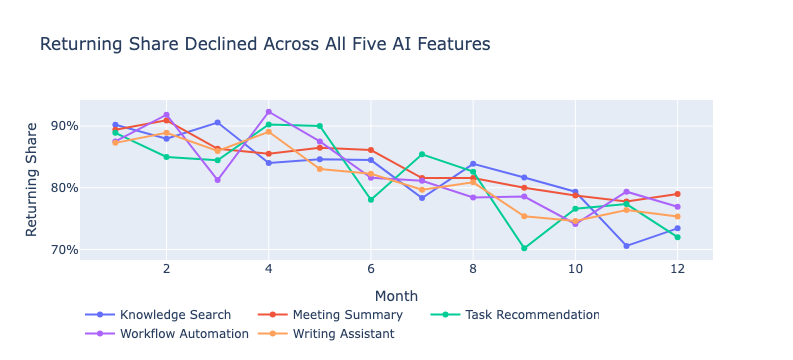
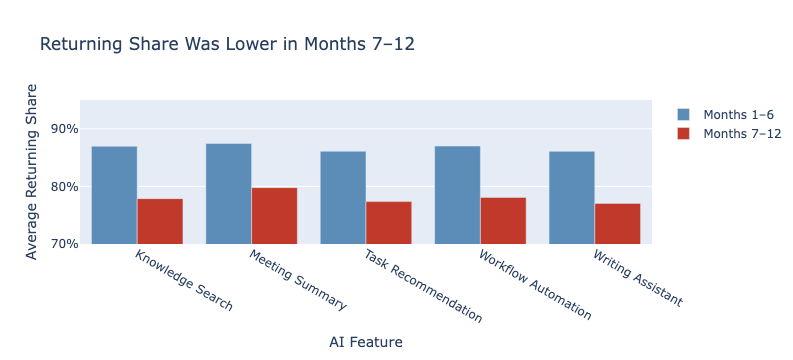
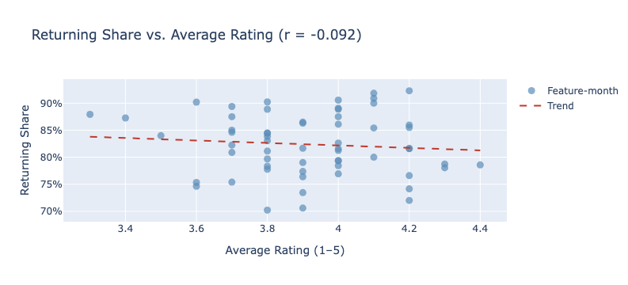

# AI Feature Engagement & Measurement Reliability

Individual project for an MBA course in programming and data analytics (ASU W. P. Carey, 2026), using a course-provided case dataset for a fictional software company, Synapse Workspace.

## Purpose

Active users grew 11–35% for all five of the company's AI features over twelve months. The purpose of this analysis was to determine whether that growth reflected users returning to the features, or whether it masked a retention problem.

Business questions:

1. Is the share of users who return to each AI feature rising or falling, and which features retain users best?
2. Is the pattern specific to certain features, or does it hold across the platform?

## Data

Three course-provided files covering five AI features over twelve months: monthly usage (active, new, and returning users), customer feedback and ratings, and a feature catalog.

Data preparation included checks for duplicates and missing values (none found) and a validation that new plus returning users equals active users in every row. Because of that identity, returning share and new-user share are mirror images, so only returning share was retained. The catalog's launch dates contradicted the usage data, so launch timing was excluded rather than reconciled by assumption.

## Findings

- **Returning share fell for every feature,** by 7.7 to 9.1 points between the first and last six months. A paired t-test confirmed the drop wasn't chance (t = 33.20, p < 0.001).

- **The decline was platform-wide.** All five features fell by nearly the same amount, and feature complexity explained none of the difference (82.6% vs. 82.2%).

- **Ratings would have missed it.** Average ratings held at about 3.9–4.0 and drifted slightly up while returning share fell. The two were uncorrelated (r = −0.092, p = 0.485).

- **The decline wasn't users leaving.** Returning users actually grew from 235 to 252. New users grew from 30 to 81, so the share fell because its denominator grew faster. Usage per active user also rose, from 1.45 to 2.38.

## Validation and revised interpretation

The initial interpretation attributed the decline to fewer users returning. To test that conclusion, an independent analysis was run in ChatGPT using the same data and questions, without access to the original findings. It decomposed the ratio into its components and showed that returning users had grown, meaning the decline reflected a change in user mix rather than a loss of users. The conclusion and recommendations were revised accordingly.

## Recommendations

- Report new, returning, and active users as separate numbers, not one ratio.
- Focus on turning new users into repeat users, rather than fixing individual features.
- Don't use satisfaction ratings as an early warning for retention. They missed this pattern entirely.
- Move to cohort tracking with individual user histories.

## Limitations

- The data is monthly totals, not individual user histories, so returning share isn't true retention. It can't show whether the same people came back.
- Five features over twelve months supports direction, not modeling.
- All findings are correlational.
- Ratings come only from users engaged enough to respond, so users who stopped returning are underrepresented.

## Files

- `retention_analysis.ipynb`: the full analysis, from data preparation through statistical tests, charts, and findings
- `app.py`: an interactive web report of the findings, built with Streamlit (run with `streamlit run app.py`)
- `images/`: charts used in this README

The course dataset is not included. To rerun the analysis, place `ai_feature_usage.csv`, `feature_feedback.csv`, and `feature_catalog.csv` in the same folder as the notebook.
